# Energy-Efficient Approximate Computing for ML

Group project for CECS 530 (Fall 2026).

How much energy can a neural network save by replacing its exact 8-bit multipliers with
approximate ones from [EvoApproxLib](https://github.com/ehw-fit/evoapproxlib), and what does it
cost in accuracy? We tested all 36 approximate multipliers of the library, first on a small digits
dataset, then on MNIST, Fashion-MNIST, CIFAR-10 and CIFAR-100.

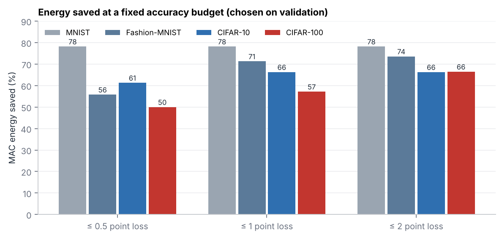

**Main results**

- On small handwritten digits, one multiplier (`mul8u_1AGV`) cut multiplier energy by **about 75%
  with no loss in accuracy**.
- On harder data there is less room. Allowing at most a 1-point accuracy loss, the energy saved
  (multiplier + adder) falls from **78% on MNIST** to 71% on Fashion-MNIST, 66% on CIFAR-10 and
  **57% on CIFAR-100**.
- The best multiplier for one dataset is often not safe on another, and accuracy alone hides how
  many predictions change.
- A small CNN is much more accurate on CIFAR but tolerates approximation **less**: 54% saved at a
  1-point budget on CIFAR-10, against 66% for the MLP.
- Retraining with the approximate multiplier in the loop recovers most of the loss on MNIST and
  Fashion-MNIST, but little on CIFAR-100. The library's power figures hold up after our own
  synthesis (rank correlation 0.997).
  
## How it works

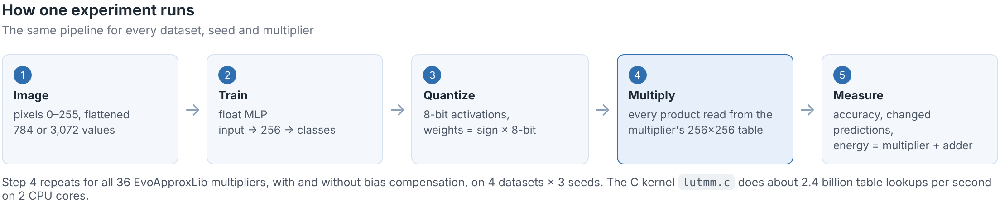

1. **Lookup tables.** `build_luts.py` compiles the C model of each of EvoApproxLib's 36 unsigned
   8×8 multipliers and stores its result for all 65,536 input pairs in a 256 × 256 table. Power and
   error figures come from the library.
2. **8-bit network.** A small MLP is trained in floating point, then quantized: activations become
   unsigned 8-bit values (inputs and ReLU outputs are never negative), and weights become a sign
   plus an 8-bit magnitude, so an unsigned multiplier can be used.
3. **Approximate inference.** Every product `x · |w|` is read from the chosen multiplier's table.
   A small C kernel (`lutmm.c`) does about 2.4 billion lookups per second on 2 CPU cores, and gives
   exactly the same result as a plain NumPy version.
4. **Energy.** Each multiply-accumulate (MAC) counts the multiplier plus an exact 16-bit adder
   (`add16u_1E2`, 0.072 mW). Because the adder always costs energy, no multiplier can save more than
   84% of MAC energy.

## What an approximate multiplier does

An approximate multiplier gives up some exactness in return for a smaller, lower-power circuit.
Each map below shows its error for every one of the 65,536 pairs of 8-bit inputs.

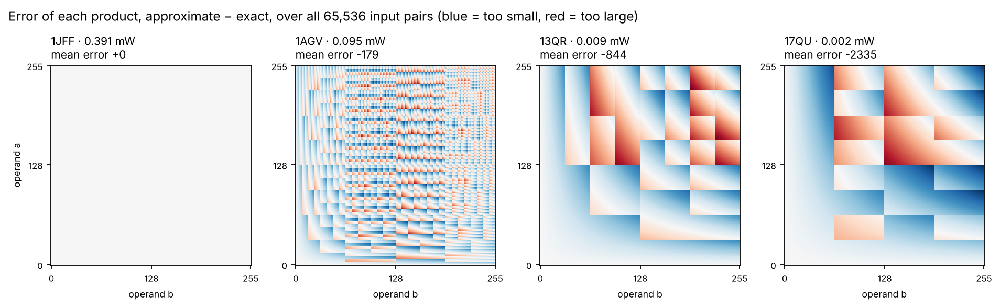

*The exact multiplier (left) has no error. Cheaper circuits make larger errors, and most of them
lean toward results that are too small (blue). Summed over hundreds of products in a neuron, that
lean builds up into a bias.*

## Part 1: digits dataset

scikit-learn's 8×8 handwritten digits, a 64-64-10 network.

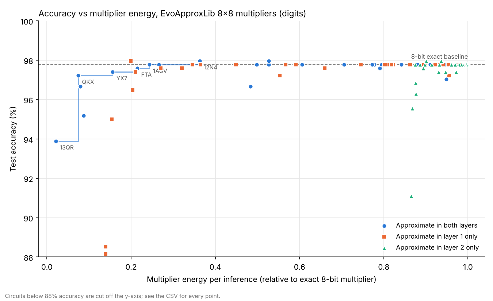

*Each dot is one multiplier used in both layers. The staircase is the Pareto front: no other
multiplier is both cheaper and more accurate.*

| Setup (seed 0, 540 test images) | Accuracy | Multiplier energy |
|---|---|---|
| 8-bit exact (`mul8u_1JFF`) | 97.78% | 1.00 |
| `mul8u_1AGV`, both layers | 97.78% | 0.24 |
| `mul8u_FTA`, both layers | 97.59% | 0.21 |
| `mul8u_QKX`, both layers | 97.22% | 0.07 |
| `mul8u_13QR`, both layers | 93.89% | 0.02 |
| `mul8u_17QU`, both layers | 72.22% | 0.004 |

### Improved backend: `approx_backend.py`

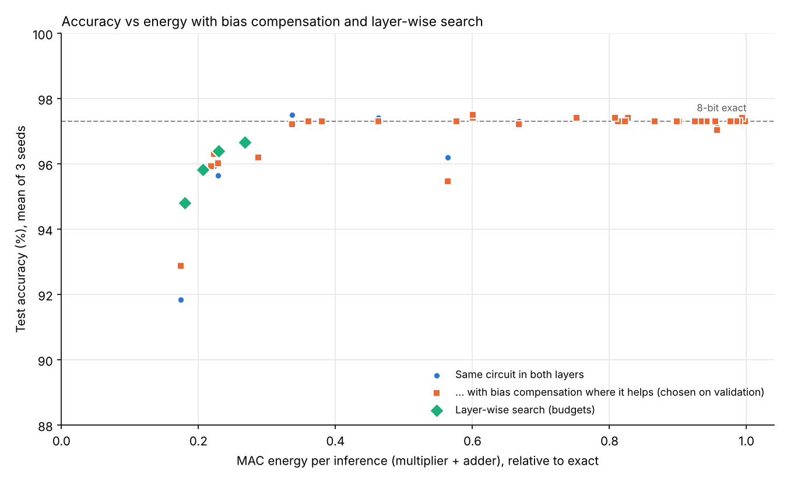

- **Bias compensation at no hardware cost.** Each product's expected error is estimated on
  calibration data and folded into the neuron biases. It is switched on only when it helps on the
  validation set.
- **Layer-wise search.** Each layer gets its own multiplier: the cheapest one that stays within an
  accuracy budget on validation.
- **Separate train, validation and test sets, three seeds.**

| Setup (mean of 3 seeds) | MAC energy | Test accuracy |
|---|---|---|
| 8-bit exact | 1.00 | 97.31% |
| `mul8u_1AGV`, both layers | 0.36 | 97.31% |
| `mul8u_13QR`, plain → compensated | 0.17 | 91.85% → 92.87% |
| `mul8u_17QU`, plain → compensated | 0.16 | 66.39% → 79.07% |
| Layer-wise search, 0.5-point budget | 0.23 | 96.39% |

The search stays within the budget on validation; on test it lost 0.9 points.

## Part 2: four datasets

Do these savings hold on harder data? We ran all 36 multipliers in the same kind of network, an
MLP with one hidden layer of 256 neurons, on four standard datasets, 3 seeds each. The multiplier is
chosen on a 5,000-image validation set and reported on the official 10,000-image test set.

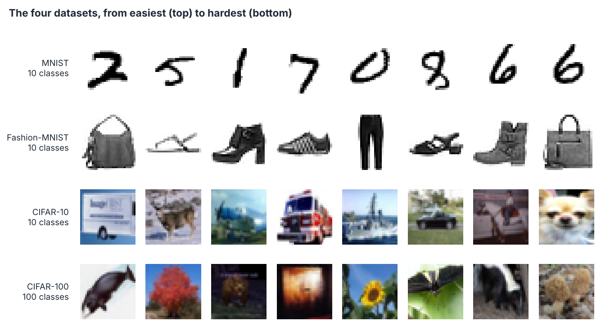

| Dataset | Float accuracy | 8-bit exact | MAC energy saved, ≤ 1-point loss | Multiplier energy saved | Test drop |
|---|---|---|---|---|---|
| MNIST | 97.94% | 97.94% | 78.2% | 92.6% | 0.21 pp |
| Fashion-MNIST | 89.14% | 89.13% | 71.3% | 84.4% | 0.76 pp |
| CIFAR-10 | 46.62% | 46.52% | 66.3% | 78.5% | 0.56 pp |
| CIFAR-100 | 20.64% | 20.42% | 57.2% | 67.7% | 0.72 pp |

### Harder datasets lose accuracy at lower savings

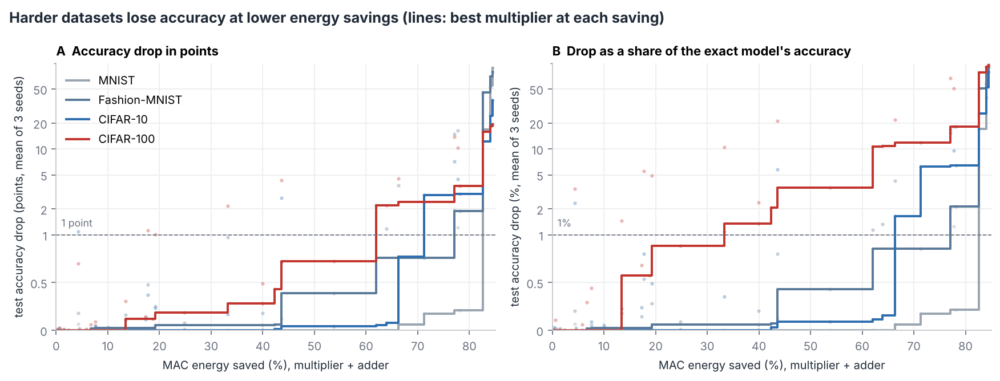

*Lines show the best multiplier at each energy saving; faint dots are all multipliers. Panel B
divides the drop by the exact model's accuracy: relative to what it had, CIFAR-100 loses the most.*

### The same multiplier costs different amounts on each dataset

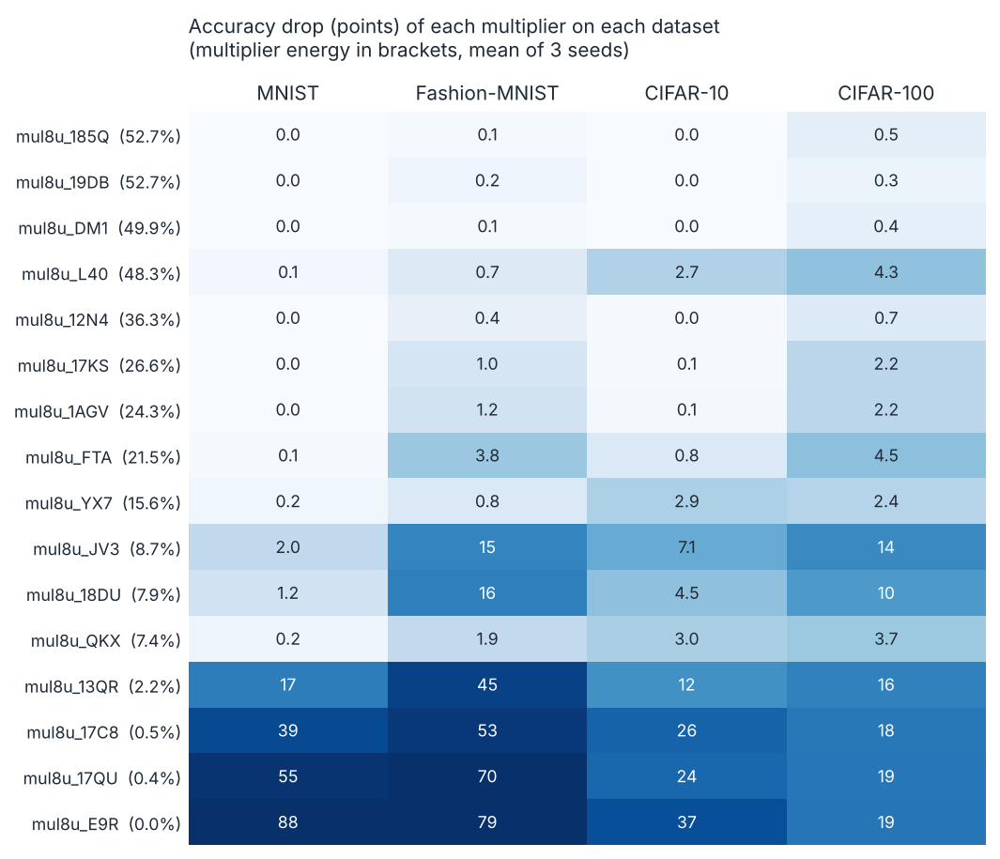

*`mul8u_QKX` is the best choice for MNIST (0.2 points lost at 7.4% of the energy) but loses 3.0
points on CIFAR-10. Below about 2% of exact energy (`mul8u_13QR` and cheaper), every dataset
collapses.*

### Accuracy hides how many predictions change

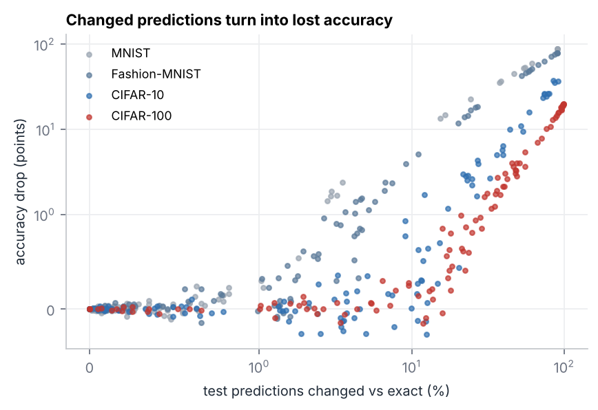

*With `mul8u_1AGV`, 0.6% of MNIST predictions change, against 4.8% on Fashion-MNIST, 12.5% on
CIFAR-10 and 41% on CIFAR-100. On hard tasks many predictions change before accuracy drops,
partly because many of them were already wrong.*

**Bias compensation rarely helps here.** It helped the most aggressive multipliers (for example
`mul8u_13QR` on CIFAR-10, 12.1 → 9.1 points lost), but often hurt the useful ones: `mul8u_QKX` lost
2.30 points on MNIST with it, against 0.21 without.

**Limits.** An MLP is a weak model for CIFAR (46.5% and 20.4%); Part 3 repeats the study with a
CNN. Energy is estimated from the library's 45 nm figures, not measured, and does not count memory.

## Part 3: scaling up

Six follow-up studies. The CNN uses 2 seeds; the others are smaller, exploratory runs (noted
below).

### A CNN on the four datasets (`run_cnn.py`)

A small CNN written in NumPy: two 3×3 convolution layers (16 and 32 channels, each followed by
ReLU and 2×2 max pooling) and one dense layer, trained with Adam for 8–15 epochs. All three layers
run 8-bit through the same lookup tables; convolutions become matrix multiplies (im2col). Same
procedure as Part 2: multiplier chosen on validation, reported on test, 2 seeds.

| Dataset | MLP, 8-bit | CNN, 8-bit | MAC saved at ≤ 1 point: MLP | CNN |
|---|---|---|---|---|
| MNIST | 97.94% | 98.82% | 78.2% | 78.2% |
| Fashion-MNIST | 89.13% | 89.87% | 71.3% | 57.9% |
| CIFAR-10 | 46.52% | 67.70% | 66.3% | 53.8% |
| CIFAR-100 | 20.42% | 37.13% | 57.2% | 53.8% |

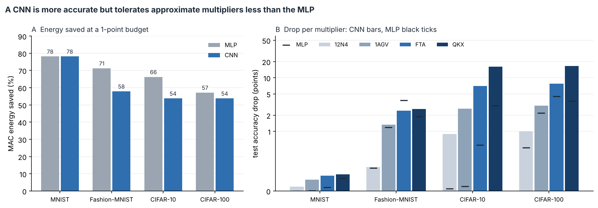

*The CNN is far more accurate on CIFAR, but every multiplier costs it more: `mul8u_QKX` loses 16
points on CIFAR-10 with the CNN against 3 with the MLP. Errors made in the first convolution are
passed on through two more approximate layers, and each convolution output sums only 9–144
products, so errors average out less than in the MLP's first layer (784–3,072 products per neuron).*

### Retraining with approximate multipliers (`retrain.py`)

Fine-tune the MLP for 3 epochs with the approximate multiplier in the forward pass (every product
read from its table) and a straight-through estimator for gradients. Mean of 2 seeds, test
accuracy (%):

| Dataset | Multiplier | 8-bit exact | Plain | Compensated | Retrained | Retrained + compensated |
|---|---|---|---|---|---|---|
| MNIST | `mul8u_13QR` | 97.94 | 82.70 | 83.08 | **97.08** | 71.84 |
| MNIST | `mul8u_17QU` | 97.94 | 45.29 | 47.14 | **92.82** | 45.92 |
| Fashion-MNIST | `mul8u_13QR` | 89.06 | 41.43 | 28.96 | **80.59** | 23.66 |
| Fashion-MNIST | `mul8u_17QU` | 89.06 | 15.88 | 14.65 | **71.61** | 12.42 |
| CIFAR-10 | `mul8u_13QR` | 47.11 | 34.40 | 37.71 | **39.98** | 22.01 |
| CIFAR-100 | `mul8u_13QR` | 20.78 | 3.64 | 4.36 | 4.82 | 1.60 |

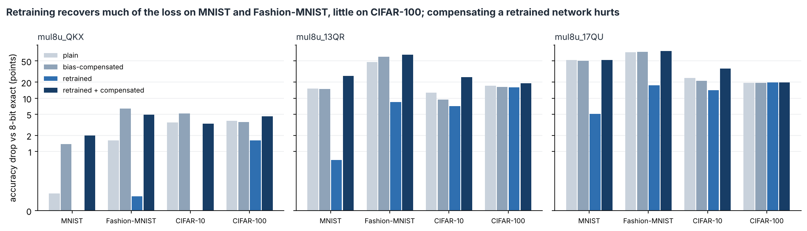

- Retraining recovers most of the loss on MNIST and Fashion-MNIST, less on CIFAR-10 and almost
  nothing on CIFAR-100, where these multipliers leave too little signal to learn from.
- Compensating a retrained network hurts badly: retraining already adapted the weights to the
  multiplier's bias, so removing the bias again over-corrects.
- Control: fine-tuning the exact network for the same 3 epochs gains 0.1–2.4 points
  (`retrain.csv`, rows `mul8u_1JFF`), so part of any gain on CIFAR-10 is just extra training.
- This retraining baseline is trained on float32 inputs, so its exact accuracy differs slightly
  from Part 2.

### Checking the hardware numbers (`hardware/`)

Yosys could not be installed in our environment, so we used [ABC](https://github.com/berkeley-abc/abc)
directly, the logic-synthesis engine that Yosys itself calls. For each of the 36 multipliers,
`hardware/check_hardware.py`:

1. simulates its gate-level Verilog netlist on all 65,536 inputs: **all 36 match the lookup
   tables exactly**;
2. optimizes and maps it with ABC onto a small generic cell library (`hardware/cells.genlib`), and
   checks with ABC's `cec` that the function did not change;
3. counts gate output switches per multiplication (the main driver of dynamic power), for random
   inputs and for the real operand stream of a trained network on MNIST and CIFAR-10.

| Measure | Spearman rank correlation with the library's power |
|---|---|
| Library area | 0.992 |
| Gates in the netlist | 0.985 |
| Area after ABC synthesis | 0.997 |
| Switching, random inputs | 0.986 |
| Switching, MNIST operands | 0.987 |
| Switching, CIFAR-10 operands | 0.989 |

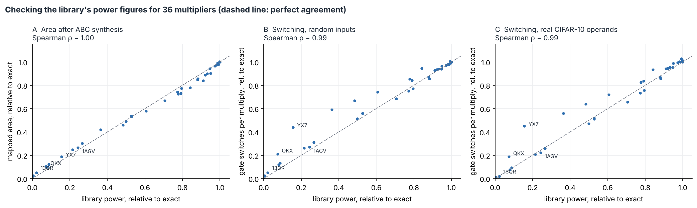

*The ranking holds. Two of the cheap multipliers switch more than their power figure suggests:
`mul8u_YX7` (15.6% of exact power, about 44% of the exact switching) and `mul8u_QKX` (7.4% and
about 20%). Real data also switches much less than random inputs: 80% of MNIST pixels are 0, so the
exact multiplier toggles 20.9 gates per multiply on MNIST against 105.9 on random inputs.*

`hardware/synth.sh` runs the same ABC flow on one multiplier.

### Which error metric predicts the damage (`analyze_metrics.py`)

Spearman rank correlation between each metric and the accuracy drop, over the 35 approximate
multipliers:

| Network | Dataset | MAE | Worst-case error | Bias | Error probability |
|---|---|---|---|---|---|
| MLP | MNIST | 0.59 | 0.58 | 0.53 | 0.40 |
| MLP | Fashion-MNIST | 0.94 | 0.90 | 0.91 | 0.79 |
| MLP | CIFAR-10 | 0.80 | 0.81 | 0.78 | 0.53 |
| MLP | CIFAR-100 | 0.95 | 0.91 | 0.91 | 0.74 |
| CNN | MNIST | 0.88 | 0.84 | 0.84 | 0.72 |
| CNN | Fashion-MNIST | 0.94 | 0.92 | 0.92 | 0.70 |
| CNN | CIFAR-10 | 0.84 | 0.85 | 0.83 | 0.54 |
| CNN | CIFAR-100 | 0.96 | 0.94 | 0.92 | 0.69 |

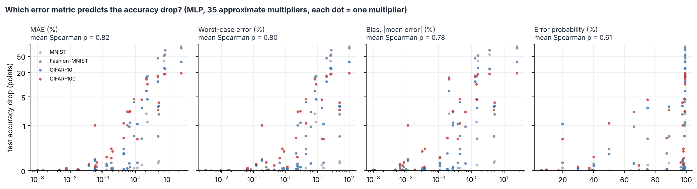

*Bias is not a better predictor than mean absolute error; MAE is the best or tied-best almost
everywhere. Error probability, how often the result is wrong at all, is the worst: many circuits
are wrong on nearly every input but only by a little.*

### Approximate adders in the accumulator (`approx_adders.py`, `lutadd.c`)

Each of EvoApproxLib's 30 approximate 16-bit adders replaces the exact accumulator adder, first
with the exact multiplier and then with `mul8u_1AGV`. MLP, seed 0, the same 2,000 random test images
for every adder (adders are simulated gate by gate, which is slow).

| Dataset | Exact multiplier: MAC saved at ≤ 1 point | `mul8u_1AGV` alone | `mul8u_1AGV` + best adder at ≤ 1 point |
|---|---|---|---|
| MNIST | 11.7% (`add16u_0GK`) | 63.9% | 75.6% (`add16u_0GK`) |
| Fashion-MNIST | 9.9% (`add16u_00G`) | 63.9% | 73.9% (`add16u_00G`) |
| CIFAR-10 | 10.8% (`add16u_0B4`) | 63.9% | 73.9% (`add16u_00G`) |
| CIFAR-100 | 7.8% (`add16u_0M0`) | 63.9%, but 2.2 points lost | none within 1 point |

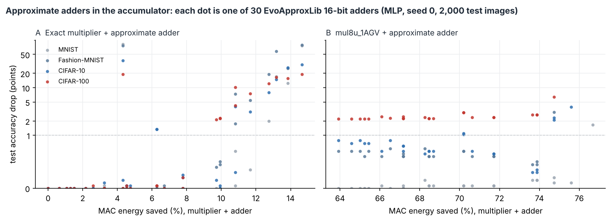

*The adder is a small part of an exact MAC (0.072 of 0.463 mW), so on its own it saves little.
Once the multiplier is cheap, the adder becomes a large share of what is left, and a good
approximate adder adds about 10 more points of saving. One adder, `add16u_1X9`, breaks every
dataset at only 4.3% saving: its error (2% MAE) builds up over hundreds of additions per neuron.*

### Signed multipliers (`signed_multipliers.py`)

The library's 13 signed 8×8 multipliers (`mul8s_*`) take two's-complement inputs directly. ReLU
activations are never negative, so they get 7 bits (0–127) and weights 8 bits. MLP, seed 0.

| Dataset (seed 0, best on test) | Unsigned + sign-magnitude: MAC saved at ≤ 1 point | Signed: MAC saved at ≤ 1 point |
|---|---|---|
| MNIST | 78.2% | 41.3% |
| Fashion-MNIST | 71.3% | 33.3% |
| CIFAR-10 | 66.3% | 33.3% |
| CIFAR-100 | 53.8% | 33.3% |

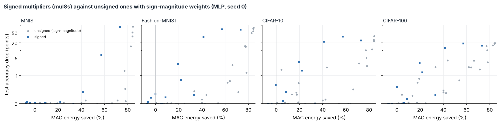

*Signed multipliers are clearly worse here. The library has only 13 of them, its exact signed
multiplier costs more than the unsigned one (0.425 against 0.391 mW), and activations lose a bit.
Sign-magnitude weights with an unsigned multiplier are the better design for ReLU networks.*

## Run it

```bash
pip install -r requirements.txt          # numpy, scipy, scikit-learn, matplotlib, pillow
git clone https://github.com/ehw-fit/evoapproxlib
python3 build_luts.py --lib evoapproxlib --out luts    # needs a C compiler (gcc or clang)

# Part 1: digits (seconds)
python3 run_experiment.py
python3 plot_results.py --dataset digits
python3 approx_backend.py                               # about 45 s

# Part 2: four datasets
bash get_data.sh                                        # about 400 MB into data/
python3 cross_dataset.py                                # about 45 min on 2 CPU cores
python3 cross_dataset.py --datasets mnist --seeds 1     # quick test, about 1 min
python3 plot_cross_dataset.py
python3 docs/make_readme_images.py

# Part 3
python3 run_cnn.py                                      # about 2.5 h on 2 CPU cores (--resume continues)
python3 plot_cnn_vs_mlp.py
python3 retrain.py                                      # about 1.5 h
python3 analyze_metrics.py                              # seconds, after cross_dataset.py and run_cnn.py
python3 hardware/check_hardware.py --abc path/to/abc    # ABC from github.com/berkeley-abc/abc
python3 approx_adders.py                                # about 50 min
python3 signed_multipliers.py                           # about 10 min
```

What a full run of `cross_dataset.py` prints:

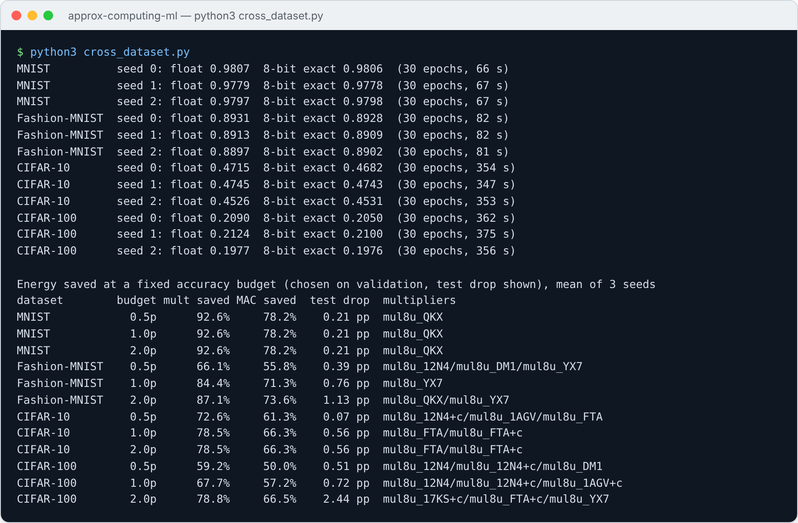


### Done

- [x] Lookup tables for all 36 unsigned 8×8 multipliers in EvoApproxLib (`build_luts.py`)
- [x] 8-bit quantized network with exact and approximate inference (`run_experiment.py`)
- [x] Accuracy vs energy plot and Pareto front (`plot_results.py`)
- [x] Multiplier-plus-adder energy model (`approx_backend.py`)
- [x] Bias compensation folded into neuron biases
- [x] Layer-wise multiplier search with an accuracy budget
- [x] Separate train, validation and test sets over three seeds
- [x] Fast C lookup-table kernel (`lutmm.c`)
- [x] Study on MNIST, Fashion-MNIST, CIFAR-10 and CIFAR-100 (`cross_dataset.py`)

- [x] Small CNN, 8-bit, on the four datasets, compared with the MLP (`run_cnn.py`)
- [x] Retraining with approximate multipliers: plain, compensated, retrained, both (`retrain.py`)
- [x] Hardware check: netlist equivalence, ABC synthesis, switching activity (`hardware/`).
      Yosys was not available, so we used ABC, the synthesis engine Yosys runs.
- [x] Error metrics against accuracy drop (`analyze_metrics.py`)
- [x] Approximate adders in the accumulator (`approx_adders.py`)
- [x] Signed multipliers (`signed_multipliers.py`)
- [x] Final report and slides


## References

- V. Mrazek et al., "EvoApprox8b: Library of approximate adders and multipliers for circuit design
  and benchmarking of approximation methods," DATE 2017.
- V. Mrazek, L. Sekanina and Z. Vasicek, "Libraries of approximate circuits: Automated design and
  application in CNN accelerators," IEEE JETCAS, 2020.
- V. Mrazek et al., "ALWANN: Automatic Layer-Wise Approximation of Deep Neural Network Accelerators
  without Retraining," ICCAD 2019.
- Y. LeCun et al., "Gradient-based learning applied to document recognition," Proc. IEEE, 1998 (MNIST).
- H. Xiao, K. Rasul and R. Vollgraf, "Fashion-MNIST," arXiv:1708.07747, 2017.
- A. Krizhevsky, "Learning multiple layers of features from tiny images," tech. report, 2009 (CIFAR).
